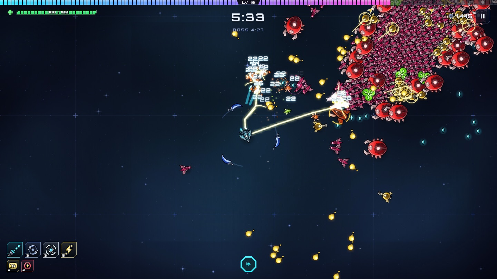
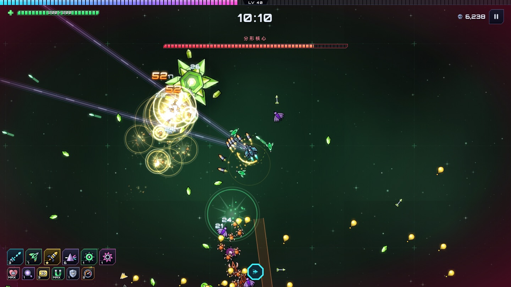
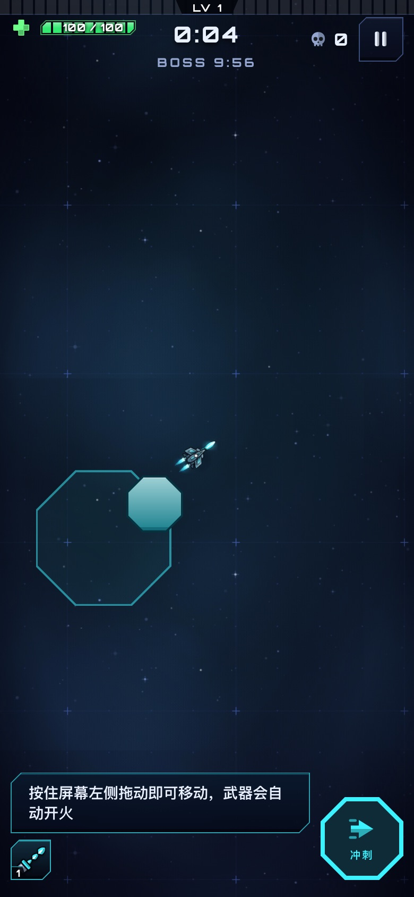
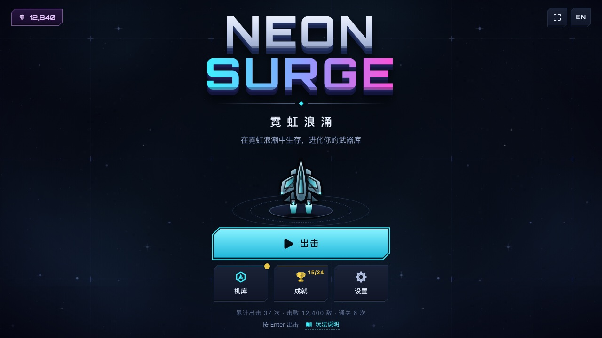
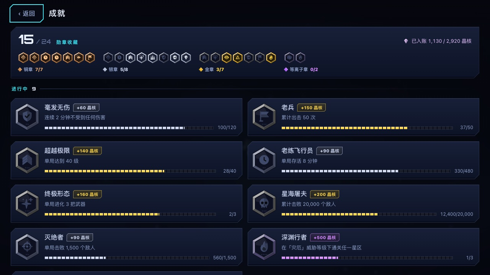
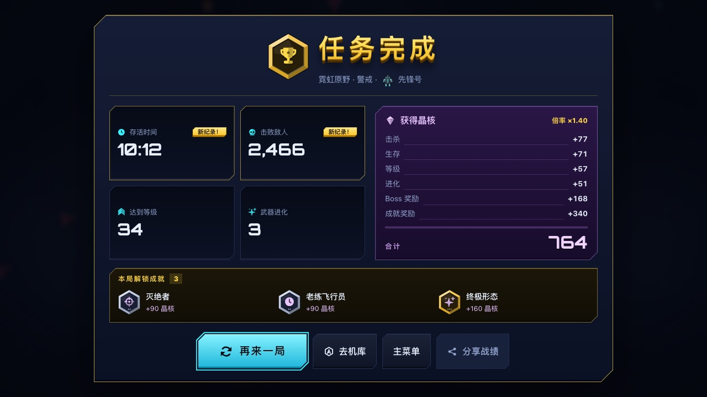
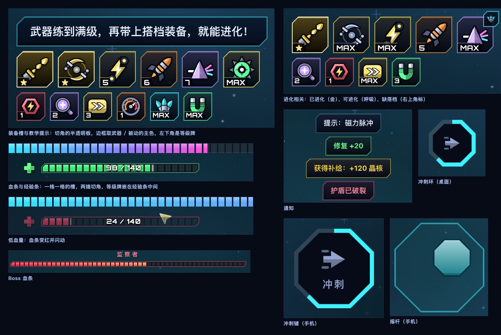

# 霓虹浪涌 · NEON SURGE

> 免费在线的霓虹生存肉鸽射击游戏。自动开火、收集晶体、升级并**进化**武器，击败三大星区的 Boss。
> 打开网页就能玩——无需下载、注册，支持电脑 / 手机 / 手柄，可离线游玩。
>
> **在线试玩：<https://aigames.de5.net/>**　·　[English](https://aigames.de5.net/en/)　·　[游戏指南](https://aigames.de5.net/guide/)

| 战斗 | Boss | 手机竖屏 |
| --- | --- | --- |
|  |  |  |

| 主菜单 | 成就 | 结算 |
| --- | --- | --- |
|  |  |  |



## 游戏内容

- **10 种武器 × 12 种被动**：脉冲炮、环绕刃、电弧链、追踪导弹、棱镜激光、磁暴地雷、冲击波、僚机无人机、回旋飞轮、磁轨炮……每次升级三选一（可重抽 / 放逐）。
- **武器进化**：武器升到 8 级并持有搭档被动，就能在升级或补给箱里进化成终极形态，特效与威力质变。进化瞬间有「蓄力 → 整屏冲击波 → 慢动作 → 铭牌式横幅」的完整演出（四周暗角聚焦，白闪只一瞬），进化后的武器会在飞船周围留下常驻光环。
- **打击感**：伤害数字分 8 档梯度（渐变字形，字号、色温、斜体随伤害逐级升级，日常数字克制、重击才上色，暴击再升一档），重击带冲击环与震屏，进化武器开火时有额外的光环与低频声。
- **轮廓优先的哑光美术**：每种敌人、每艘飞船、每个 Boss 都是部件拼成的生物 / 机器——黄蜂、六足螨、甲虫、炮塔虫、三叶体、长矛头、尖刺水雷、盾卫、破布幽灵、晶簇；遮住颜色只看剪影也认得出。机体是带深色描边与明暗面的实心件，只在灯位点一小粒自发光；子弹是实心弹珠、脚下有接触阴影；泛光带阈值，人潮里也不会糊成一团雾。宝石按档位有四种切工；拾取物和武器小件同样先有轮廓——十字医疗箱、马蹄磁铁、带引信的炸弹、带锁的宝箱、立在底座上的晶体，弯月镰刀、钩齿锯盘、后掠翼僚机、带刺的地雷；光束武器各有各的结构（带色散的棱镜激光、绕着白芯旋转的磁轨双螺旋、分叉的电弧、带装甲环的冲击波），敌方弹幕一种一个形状（酸液、瞳孔、飞镖、晶刺、獠牙），Boss 射线带警示斜纹、冲击环长着尖齿。
- **成套的图标**：10 把武器、12 个被动各是一件认得出来的小物件——斜指的炮管连射光弹、首尾追逐的一对弯刀、白光折成三色的棱镜、带钢轨与线圈的磁轨炮；磁铁、盾、放大镜、四叶草、仪表盘……墨线描边 + 三层明暗，和局内精灵同一套哑光语言，缩到 20 像素仍是清晰的剪影；每件的主题色在 HUD、升级卡、机库里保持一致；功能图标统一为实心双色符号。全部由代码绘制，没有任何第三方图标集。
- **成套的界面**：按钮、卡片、标签、分段条统一成切角的哑光钢板——有厚度和倒角、没有发光，键盘焦点是一圈镂空的切角框；主菜单有金属挤出的 Logo 和站在底座上的飞船；24 个成就是六边形金属勋章，按奖励分铜 / 银 / 金 / 等离子四档（颜色之外还有 1~4 个点标记，色觉不同也分得清）；结算页是战果徽章 + 读数格 + 晶核账单（逐行相加恰好等于合计）。战斗里的装备槽、通知、教学提示、血条、冲刺键和手机摇杆也是同一套钢板（半透明，叠在战场上不遮挡；血条是一格一格的槽，冲刺键与摇杆是八边形）。手机竖屏 / 横屏、平板、桌面都做过整页版面审计（`node scripts/e2e.mjs pages`）与 HUD 版面审计（`node scripts/e2e.mjs layout`）。
- **3 个星区 × 3 个 Boss**：霓虹原野（监察者）、数据荒原（分形核心）、虚空裂隙（虚空之喉），每个星区 10 分钟，Boss 有多阶段弹幕与独特机制；10 种敌人 + 精英怪。
- **机库永久成长**：13 项永久升级、4 艘风格迥异的飞船、4 档威胁等级、通关后解锁无尽模式、24 个成就。
- **全平台**：键盘 WASD / 方向键、触屏浮动摇杆 + 冲刺按钮、手柄；自动画质 + 三档手动画质；存档本地保存，支持导入 / 导出。
- **实时合成的音乐与音效**：全部由 WebAudio 合成，没有任何音频文件；每个星区有自己的音阶，Boss 战自动变奏。
- **中英双语**，页面路径决定语言（`/` 中文，`/en/` English）。

### 操作

| 设备 | 移动 | 冲刺（短暂无敌） | 暂停 |
| --- | --- | --- | --- |
| 键盘 | `W A S D` / 方向键 | `空格` / `Shift` | `Esc` / `P` |
| 触屏 | 按住屏幕左侧拖动（浮动摇杆） | 右下角按钮 | 右上角按钮 |
| 手柄 | 左摇杆 / 十字键 | `A` / `B` / `RB` / `RT` | `Start` |

武器全部自动开火，专注走位、捡晶体、选对构筑即可。

## 本地开发

需要 Node.js 22（见 `.nvmrc`）。

```bash
npm install
npm run dev        # 开发服务器 http://127.0.0.1:5173
npm run build      # 生成静态页 → 类型检查 → 打包到 dist/
npm run preview    # 预览 dist/
npm test           # 单元 / 模拟 / 图标测试（126 项）
npm run sim -- --all   # 机器人无头整局模拟：查崩溃、看难度曲线
npm run bench          # 武器基准：每把武器在人潮 / Boss 单挑里的有效 DPS（加新武器时对照用）
npm run icons          # 图标样张（设计稿大图 + 真实使用尺寸）；加 `-- --check` 做越界体检（改图标后必跑）
```

无头浏览器验证（**不会弹出任何窗口**，截图写入 `.e2e/`；需先 `npm run build` 且本机装有 Chromium headless shell，或设置 `CHROME_PATH`）：

```bash
node scripts/e2e.mjs smoke     # 冒烟：能启动、无控制台错误、能开局并推进、音频有输出且不削波
node scripts/e2e.mjs desktop   # 桌面全流程截图：菜单→机库→成就→设置→出击→升级→暂停→Boss→结算
node scripts/e2e.mjs mobile    # 手机横/竖屏模拟：触屏摇杆、冲刺、升级面板
node scripts/e2e.mjs pwa       # Service Worker：激活、离线可玩、新版本提示、清单与图标
node scripts/e2e.mjs flows     # 关键流程：英文界面、失败结算、机库购买与存档、暂停放弃、手柄导航
node scripts/e2e.mjs fx        # 打击感：伤害数字字样本 + 8 档梯度截图 + 武器进化演出时序断言（导演启动→爆发→横幅→恢复）
node scripts/e2e.mjs layout    # 版面审计：手机竖/横屏、平板、桌面，满配与开局两种状态下 HUD 元素互不遮挡、不出屏
node scripts/e2e.mjs pages     # 整页版面审计：7 种屏幕 × 中英文 × 菜单 / 成就 / 机库 / 出击 / 设置 / 暂停 / 升级 / 结算，量横向溢出、按钮文字被撑出、主操作出屏
node scripts/e2e.mjs hud       # HUD 样张：满配 / 低血量 / Boss / 进化 / 手机摇杆几种状态逐区域放大截图（--dpr 1 --lang en --only normal,low），改 HUD 样式后必须看一眼
node scripts/e2e.mjs ui        # 界面样张：以上整页界面逐屏截图（--w --h --dpr --touch 1 --lang en --only menu,ach），改界面样式后必须看一眼
node scripts/e2e.mjs art       # 美术图鉴：全部精灵（敌人 / 飞船 / 拾取物 / 武器部件 / 敌方子弹 / Boss 及整机）放大摆成几张图，改美术后必须看一眼
node scripts/e2e.mjs zoo       # 敌人动物园：全部敌人按真实朝向与比例摆一排（--dpr 2 --clip x,y,w,h 看细节）
node scripts/e2e.mjs perf --q high --dpr 2 --gpu 1   # 性能探针
node scripts/e2e.mjs live      # 对线上站点做冒烟与可用性检查
node scripts/gen-assets.mjs    # 重新生成图标与分享图（public/ 下的素材已提交）
node scripts/gen-sprites.mjs   # 重新导出玩法指南用的敌人 / 飞船 / Boss / 拾取物 / 弹幕立绘（public/img/sprites/，已提交）
```

## 技术栈与结构

TypeScript（strict）+ Vite 8，**零运行时依赖**，自研 Canvas2D 引擎；UI 字体 Orbitron（`@fontsource`，随包发布，不依赖外部 CDN）。

```
src/
  data/      内容数据（武器/被动/敌人/飞船/星区/成就/机库/平衡参数）——唯一数据源
  game/      DOM-free 模拟层：World、导演器(刷怪)、武器、敌人、Boss、掉落/升级、存档与结算、机器人
  engine/    rng、数学、空间哈希、对象池、WebAudio 合成器、输入（键盘/触屏/手柄）、feel（打击感参数：伤害分档、进化演出时间轴）
  render/    Canvas 渲染器：拼装式精灵（`matte.ts` 着色工具包 + `parts.ts` 部件工具；`creatures / shipart / bossart / props / bullets` 各管一类造型，启动时预渲染；光束 / 电弧 / 冲击环因长短粗细每帧在变，由 `beams.ts` 运行时绘制）、带阈值的降采样泛光、粒子、字形图集伤害数字（预渲染渐变/描边）、背景、Boss 绘制、镜头震动
  ui/        DOM 界面：菜单/出击/机库/成就/设置/HUD/升级/暂停/结算；`icons.ts` 是 47 个内联 SVG 图标（纯字符串，Node 里生成静态页也用）
  app/       应用编排：主循环、状态机、存档读写、PWA、自适应画质
  i18n/      中英词典（测试保证两边键完全一致）
  styles/    全站 CSS
scripts/     静态页生成(gen-pages)、素材生成(gen-assets)、无头 e2e、平衡模拟(sim)
tests/       数据一致性 / 存档与结算 / 模拟确定性与稳定性 / i18n / 图标结构与风格
public/      图标、分享图、玩法指南立绘（img/sprites）、manifest、_headers
```

更多设计细节见 [docs/ARCHITECTURE.md](docs/ARCHITECTURE.md)，发布与运营见 [docs/OPERATIONS.md](docs/OPERATIONS.md)。

## 部署

站点部署在 Cloudflare Pages，推送 `main` 即自动上线：

| 项 | 值 |
| --- | --- |
| 构建命令 | `npm run build` |
| 输出目录 | `dist` |
| Node 版本 | 22（`.nvmrc`） |
| 域名 | `https://aigames.de5.net`（不要更改；`scripts/site.ts` 的 `SITE_URL` 是 canonical / sitemap / 分享图的唯一来源） |

上线后可访问 `/version.json` 核对构建号（等于提交 SHA 前 8 位）。

## 隐私

游戏本身不使用 Cookie、不接入任何统计、不上传任何数据；存档仅保存在玩家浏览器的 `localStorage`。

## 许可

代码与游戏内的全部图形、音频均为原创（程序化绘制 / 合成）。UI 字体 [Orbitron](https://github.com/theleagueof/orbitron) 使用 SIL Open Font License。
